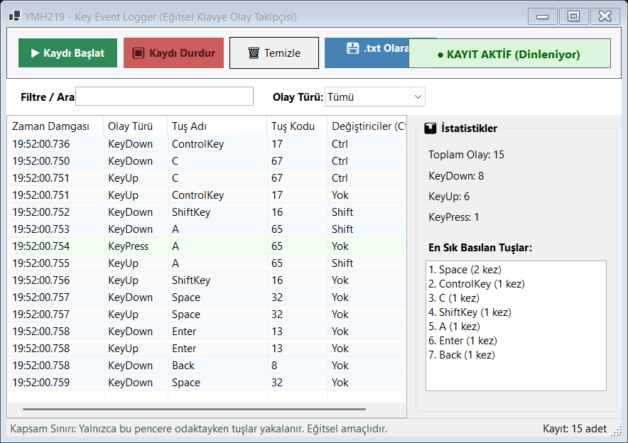
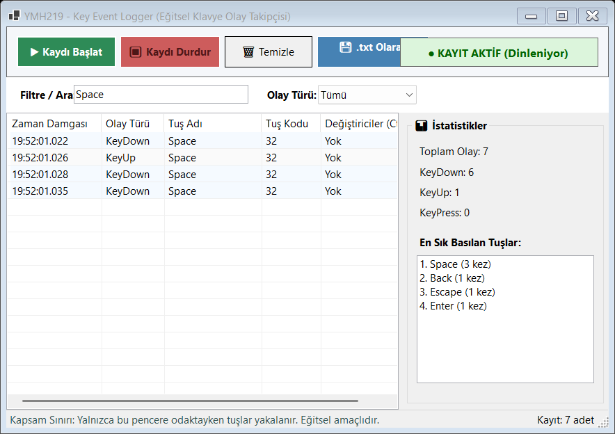

# YMH219 - Key Event Logger (Eğitsel Keylogger)

Bu proje, Fırat Üniversitesi **Nesne Tabanlı Programlama (YMH 219)** dersi kapsamında Windows Forms ortamında C# dili kullanılarak geliştirilmiş eğitsel bir klavye olay takip (Key Event Logger) masaüstü uygulamasıdır.

---

## 📌 Projenin Amacı ve Kısa Açıklama

Bu ödevde klavye olaylarının (KeyDown, KeyUp, KeyPress) Windows Forms mimarisinde nasıl yakalandığı, olay bilgilerinin nesne tabanlı bir model ile nasıl işlendiği, listelendiği ve yerel bir metin dosyasına (.txt) nasıl aktarıldığı gösterilmektedir.

---

## 🛡️ Kapsam ve Güvenlik Sınırı

> **Önemli Güvenlik Bildirimi:**
> Bu uygulama gerçek bir sistem keyloggerı veya zararlı yazılım **değildir**.
> - Uygulama **yalnızca kendi form penceresi odaktayken** basılan tuşları yakalar.
> - Global keyboard hook, arka planda/gizli çalışma, Windows başlangıcında otomatik başlama, şifre/kimlik bilgisi toplama, diğer uygulamaları izleme veya ağ üzerinden veri gönderme gibi işlevler **kesinlikle bulunmamaktadır**.
> - Tamamen eğitim ve klavye olay mekanizmalarını öğrenme amaçlıdır.

---

## 🛠️ Kullanılan Teknolojiler

- **Programlama Dili:** C# (.NET 10.0 / Windows Desktop SDK)
- **Arayüz Çerçevesi:** Windows Forms (WinForms, ListView, FlowLayoutPanel)
- **Klavye Olayları:** `KeyPreview`, `KeyDown`, `KeyUp`, `KeyPress`, `ProcessCmdKey`
- **Dosya İşlemleri:** `System.IO` (StreamWriter, UTF-8 kodlama)
- **Harici NuGet paketi:** Yok
- **Sürüm Kontrolü:** Git & GitHub

---

## 🚀 Kurulum ve Çalıştırma Adımları

### Gereksinimler
- Windows 10 veya Windows 11
- [.NET 10 SDK](https://dotnet.microsoft.com/download/dotnet/10.0)
- Visual Studio 2026 (".NET masaüstü geliştirme" iş yükü) **veya** komut satırı için yalnızca .NET 10 SDK

> Proje `net10.0-windows` hedeflediği için Visual Studio 2022 ile açılamaz.

### Çalıştırma
1. Projeyi bilgisayarınıza klonlayın:
   ```bash
   git clone https://github.com/BirgulGokturk/YMH219-KeyEventLogger.git
   cd YMH219-KeyEventLogger
   ```
2. Projeyi derleyin ve çalıştırın:
   ```bash
   dotnet build
   dotnet run
   ```
   *Veya `YMH219_KeyEventLogger.sln` dosyasını Visual Studio ile açarak F5 tuşuna basabilirsiniz.*

### Kullanım
1. "▶ Kaydı Başlat" butonuna tıklayın; sağ üstteki gösterge yeşile döner ve klavye odağı kayıt listesine geçer.
2. Pencere aktifken tuşlara basın; her tuş için KeyDown, KeyPress (karakter üreten tuşlarda) ve KeyUp olayları listelenir.
3. Arama kutusuna veya olay türü listesine tıklayıp filtre uygulayabilirsiniz; bu alanlara yazılanlar kayda eklenmez.
4. "💾 .txt Olarak Kaydet" ile kayıtları ve istatistik özetini dosyaya kaydedin.

---

## ⚙️ Uygulamanın Temel Özellikleri

### 1. Asgari Gereksinimler
- **Olay Yakalama:** Form aktifken basılan tuşların adı, tuş kodu, olay türü ve zaman damgası (milisaniye hassasiyetinde) anlık olarak listelenir. Tab tuşu da (normalde Windows tarafından odak değiştirmek için kullanılır) KeyDown olarak kaydedilir.
- **Kayıt Kontrolü:** "▶ Kaydı Başlat" ve "⏹ Kaydı Durdur" butonları ile dinleme durumu kontrol edilir. Butonlar klavye odağı almaz (`NoFocusButton`); böylece kayıt sırasında basılan Boşluk veya Enter bir butonu yanlışlıkla tetiklemez.
- **Canlı Durum Göstergesi:** Arayüzün sağ üstünde kaydın aktif mi yoksa durdurulmuş mu olduğunu belirten renkli gösterge paneli bulunur.
- **Ekranı Temizleme:** "🗑 Temizle" butonu ile listedeki kayıtlar onay alınarak sıfırlanabilir.
- **Dosyaya Kaydetme (.txt):** "💾 .txt Olarak Kaydet" butonu ile SaveFileDialog açılarak tüm olay günlüğü ve istatistik özeti metin dosyasına yazdırılır.

### 2. İsteğe Bağlı / Ek Geliştirmeler (Bonus)
- **Olay Türü Ayrımı:** `KeyDown` (tuşa basma), `KeyUp` (tuşu bırakma) ve `KeyPress` (karakter üretimi) olayları ayrı ayrı yakalanır ve farklı renk tonlarıyla listelenir.
- **Okunabilir Tuş Adları:** Görünmeyen karakterler anlaşılır adlarla gösterilir (örn. `Enter`, `Backspace`, `Esc`, `Ctrl+C`).
- **Değiştirici Tuş Takibi:** `Ctrl`, `Alt`, `Shift` tuş kombinasyonları tespit edilir.
- **İstatistik Paneli:**
  - Toplam yakalanan olay sayısı
  - Olay türü dağılımları (KeyDown / KeyUp / KeyPress)
  - En sık kullanılan ilk 7 tuşun kullanım frekans sıralaması
- **Arama ve Filtreleme:** Arama kutusu üzerinden tuş adına, tuş koduna veya değiştiriciye göre anlık filtreleme yapılabilir; ayrıca olay türüne göre (KeyDown, KeyUp, KeyPress) liste filtrelenebilir.

---

## 📸 Ekran Görüntüleri

| Kayıt ve İstatistik Ekranı | Filtreleme ve Olay Detayı |
|:---:|:---:|
|  |  |

---

## 🏗️ Nesne Tabanlı Mimari

```
YMH219-KeyEventLogger/
├── Controls/
│   └── NoFocusButton.cs  # Button'dan türeyen, klavye odağı almayan buton
├── Models/
│   ├── KeyEventType.cs   # KeyDown, KeyUp, KeyPress numaralandırması (Enum)
│   ├── KeyLogItem.cs     # Tuş adı, kodu, değiştiriciler, zaman damgası modeli
│   └── KeyStatistics.cs  # İstatistik özeti (record) ve tuş kullanım sayısı
├── Services/
│   └── LogManager.cs     # Kayıt listesi, .txt dışa aktarma, istatistik hesaplama ve filtre kuralı
├── screenshots/
│   ├── ekran1.png
│   └── ekran2.png
├── Form1.cs              # Klavye olay dinleyicileri ve form etkileşimleri
├── Form1.Designer.cs     # Form bileşenleri, ListView ve paneller
├── Program.cs            # Giriş noktası
├── YMH219_KeyEventLogger.csproj
└── YMH219_KeyEventLogger.sln
```

İstatistik hesabı ve filtre kuralı yalnızca `LogManager` sınıfında bulunur; form bu sınıfı kullanarak listeyi ve istatistik panelini günceller, .txt raporu da aynı hesaplamayı kullanır.

---

## 📝 Bilinen Sınırlamalar / Geliştirme Notları

- Güvenlik ve gizlilik standartları gereği yalnızca uygulama penceresi odaktayken (aktifken) çalışır; arka plan klavye dinlemesi yapılmaz.
- Kayıt sırasında Tab tuşu odağı başka kontrole taşımaz (kaydedilmesi için yakalanır); kontroller arasında fareyle geçiş yapılabilir.
- Kayıtlar yalnızca bellekte tutulur; uygulama kapatılmadan önce .txt olarak kaydedilmezse kaybolur.
- Kayıtları tarih/saat aralığına göre filtreleme ve JSON/CSV formatında dışa aktarma gelecek sürümlerde eklenebilir.

---

## 👤 Öğrenci Bilgileri

- **Adı Soyadı:** Birgül Göktürk
- **Öğrenci Numarası:** 250541094
- **Ders:** Nesne Tabanlı Programlama (YMH 219)
- **Dönem:** 2026-2027 Güz
