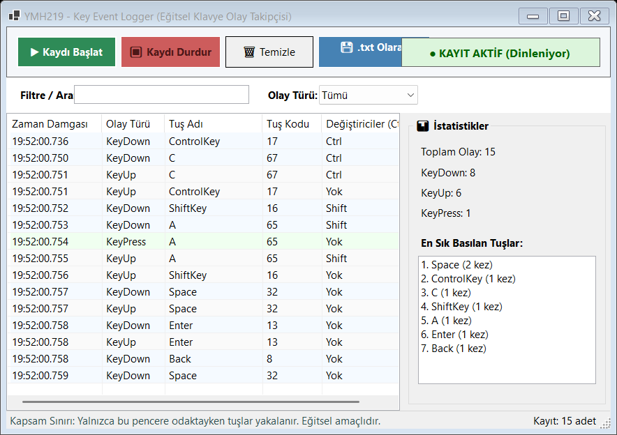
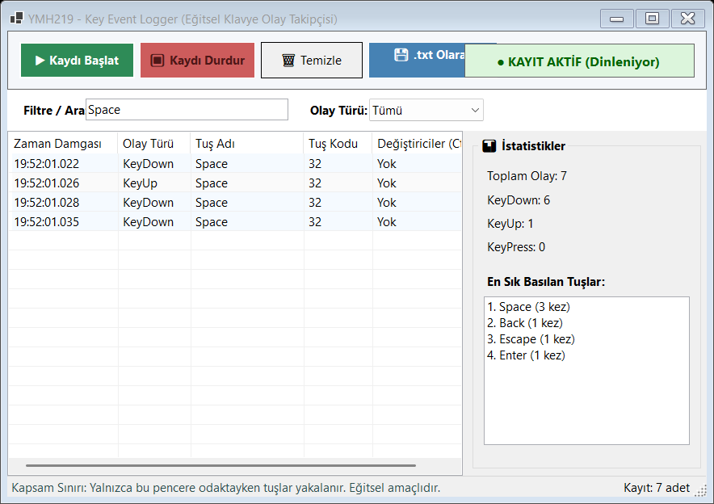

# YMH219 - Key Event Logger (Eğitsel Keylogger)

Bu proje, Fırat Üniversitesi **Nesne Tabanlı Programlama (YMH 219)** dersi kapsamında Windows Forms ortamında C# dili kullanılarak geliştirilmiş eğitsel bir klavye olay takip (Key Event Logger) masaüstü uygulamasıdır.

---

## 📌 Projenin Amacı ve Kısa Açıklama

Bu ödevde klavye olaylarının (KeyDown, KeyUp, KeyPress) Windows Forms mimarisinde nasıl yakalandığı, olay bilgilerinin nesne tabanlı bir model ile nasıl işlendiği, listelendiği ve yerel bir metin dosyasına (.txt) nasıl aktarıldığı gösterilmektedir. 

---

## 🛡️ Kapsam ve Güvenlik Sınırı

> **Önemli Güvenlik Bildirimi:**
> Bu uygulama gerçek bir sistem keyloggerı veya zararlı yazılım **değildir**. 
> - Uygulama **yalnızca kendi form penceresi odaktayken** basılan tuşları yakalar.
> - Global keyboard hook, arka planda/gizli çalışma, Windows başlangıcında otomatik başlama, şifre/kimlik bilgisi toplama, diğer uygulamaları izleme veya ağ üzerinden veri gönderme gibi işlevler **kesinlikle bulunmamaktadır**.
> - Tamamen eğitim ve klavye olay mekanizmalarını öğrenme amaçlıdır.

---

## 🛠️ Kullanılan Teknolojiler

- **Programlama Dili:** C# (.NET 10.0 / Windows Desktop SDK)
- **Arayüz Çerçevesi:** Windows Forms (WinForms)
- **Geliştirme Ortamı:** Visual Studio / VS Code
- **Dosya İşlemleri:** `System.IO` (StreamWriter, File I/O, UTF-8 kodlama)
- **Sürüm Kontrolü:** Git & GitHub

---

## 🚀 Kurulum ve Çalıştırma Adımları

1. Proje dizinine gidin:
   ```bash
   cd YMH219-KeyEventLogger
   ```
2. Projeyi derleyin ve çalıştırın:
   ```bash
   dotnet build
   dotnet run
   ```
   *Veya `YMH219_KeyEventLogger.sln` dosyasını Visual Studio ile açarak F5 tuşuna basabilirsiniz.*

---

## ⚙️ Uygulamanın Temel Özellikleri

### 1. Asgari Gereksinimler
- **Olay Yakalama:** Form aktifken basılan tuşların adı, tuş kodu, olay türü ve zaman damgası (milisaniye hassasiyetinde) anlık olarak listelenir.
- **Kayıt Kontrolü:** "▶ Kaydı Başlat" ve "⏹ Kaydı Durdur" butonları ile dinleme durumu kontrol edilir.
- **Canlı Durum Göstergesi:** Arayüzün sağ üstünde kaydın aktif mi yoksa durdurulmuş mu olduğunu belirten renkli gösterge paneli bulunur.
- **Ekranı Temizleme:** "🗑 Temizle" butonu ile listedeki kayıtlar onay alınarak sıfırlanabilir.
- **Dosyaya Kaydetme (.txt):** "💾 .txt Olarak Kaydet" butonu ile SaveFileDialog açılarak tüm olay günlüğü ve istatistik özeti metin dosyasına yazdırılır.

### 2. İsteğe Bağlı / Ek Geliştirmeler (Bonus)
- **Olay Türü Ayrımı:** `KeyDown` (tuşa basma), `KeyUp` (tuşu bırakma) ve `KeyPress` (karakter üretimi) olayları ayrı ayrı yakalanır ve farklı renk tonlarıyla listelenir.
- **Değiştirici Tuş Takibi:** `Ctrl`, `Alt`, `Shift` tuş kombinasyonları tespit edilir.
- **İstatistik Paneli:**
  - Toplam yakalanan olay sayısı
  - Olay türü dağılımları (KeyDown / KeyUp / KeyPress)
  - En sık kullanılan ilk 7 tuşun kullanım frekans sıralaması
- **Arama ve Filtreleme:** Arama kutusu üzerinden tuş adına veya değiştiriciye göre anlık filtreleme yapılabilir; ayrıca olay türüne göre (KeyDown, KeyUp, KeyPress) liste filtrelenebilir.

---

## 📸 Ekran Görüntüleri

<!-- Buraya uygulamanın ekran görüntülerini ekleyebilirsiniz (screenshots klasörüne ekran1.png ve ekran2.png olarak kaydedebilirsiniz) -->

| Kayıt ve İstatistik Ekranı | Filtreleme ve Olay Detayı |
|:---:|:---:|
|  |  |

*(Not: `screenshots/` klasörüne `ekran1.png` ve `ekran2.png` isimli ekran görüntülerinizi eklediğinizde yukarıdaki tabloda otomatik olarak görünecektir.)*

---

## 🏗️ Nesne Tabanlı Mimari

```
YMH219-KeyEventLogger/
├── Models/
│   ├── KeyEventType.cs   # KeyDown, KeyUp, KeyPress numaralandırması (Enum)
│   └── KeyLogItem.cs     # Tuş adı, kodu, değiştiriciler, zaman damgası modeli
├── Services/
│   └── LogManager.cs     # Kayıt listesi, dosya dışa aktarma (.txt), istatistik ve arama mantığı
├── screenshots/
│   └── .gitkeep          # Ekran görüntüleri klasörü
├── Form1.cs              # Klavye olay dinleyicileri ve form etkileşimleri
├── Form1.Designer.cs     # Form bileşenleri, ListView ve paneller
├── Program.cs            # Giriş noktası
├── YMH219_KeyEventLogger.csproj
└── YMH219_KeyEventLogger.sln
```

---

## 📝 Bilinen Sınırlamalar / Geliştirme Notları

- Güvenlik ve gizlilik standartları gereği yalnızca uygulama penceresi odaktayken (aktifken) çalışır; arka plan klavye dinlemesi yapılmaz.
- İlerleyen sürümlerde kayıtların JSON veya CSV formatında da dışa aktarılması eklenebilir.

---

## 👤 Öğrenci Bilgileri

- **Adı Soyadı:** Birgül Göktürk
- **Öğrenci Numarası:** 250541094
- **Ders:** Nesne Tabanlı Programlama (YMH 219)
- **Dönem:** 2026-2027 Güz
